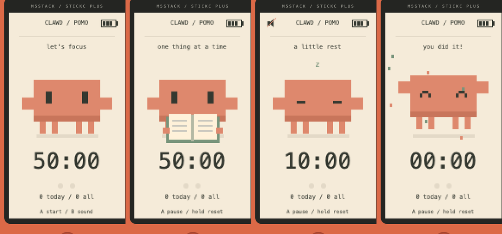

# pomo-pet

An offline pomodoro desk pet for the **M5StickC Plus 1.1**. A little pixel
companion works alongside you — typing on a laptop, reading, taking notes —
naps with you on breaks, and celebrates every finished tomato.



No Wi-Fi, no Bluetooth, no companion app. Flash it and put it on your desk.

## Features

- **Flip to focus.** Lay the stick face down for a second: the backlight turns
  off and a focus session starts (or resumes). Turn it face up to pause.
- **Two presets.** 50/10 min with a 20 min long break after 2 rounds, or
  25/5 with a 15 min long break after 4 rounds.
- **A pet that reacts.** Rotating desk props while you focus, sleeping on
  breaks, confetti when you finish. Tilt the stick and it slides to the low
  side and looks that way.
- **Distinct sounds** for start, pause, focus done, break start, break over,
  and reset. Muted mode shows an icon and blinks the red LED instead.
- **Today / all-time count**, dated by the on-board RTC (synced from your
  computer on every upload).
- **Survives power-off.** Progress is saved every minute, on every state
  change, and when you hold the power key; it comes back paused.
- **Battery-aware.** Four-bar battery gauge, charging animation on USB,
  auto-dim after 30 s idle, 80 MHz CPU.

## Controls

| Input | Action |
|---|---|
| A | Start / pause |
| Hold A (1.5 s) | Reset current timer |
| B | Sound on / off |
| Hold B (1.5 s, idle screen) | Switch 50/10 ↔ 25/5 preset |
| A + B | Next character |
| Face down 1 s / face up 1 s | Start or resume / pause focus |
| Power key, short | Wake the screen |
| Power key, hold 4 s | Power off (progress is saved first) |

When the screen is dimmed, the first press only wakes it.

## Build and flash

Requires [PlatformIO](https://platformio.org/).

```sh
pio run                                   # build
pio run -t upload --upload-port /dev/cu.usbserial-XXXX
```

After uploading, `tools/settime.py` writes your computer's local time into the
RTC automatically. Run it on its own any time:
`python tools/settime.py /dev/cu.usbserial-XXXX` (this reboots the stick;
progress is restored).

Flashing replaces whatever is on the device. To keep the factory firmware,
back it up first:

```sh
python -m esptool --chip esp32 --port /dev/cu.usbserial-XXXX read_flash 0 0x400000 backup.bin
```

`fix_speaker.py` patches M5StickCPlus 0.1.1, which initializes the buzzer
channel at 0 Hz and is rejected by Arduino-ESP32 2.x.

## Add a character

Each character is one header in `src/chars/` that draws only its body and
face; desk props, shadow, sleep and confetti effects are shared. Copy
`src/chars/clawd.h`, draw on the 7 px grid with `pixel()`, then add an entry
to `CHARACTERS` in `src/main.cpp`.

Preview without flashing — this compiles the real drawing code on your
computer and writes one row per character (idle, looking aside, asleep,
celebrating):

```sh
c++ -std=c++17 -I src tools/render_chars.cpp -o /tmp/render_chars
/tmp/render_chars chars.ppm
```

`preview/index.html` is a browser mock-up of the screen and its states.

## Credits

The Clawd pixel silhouette is based on `assets/svg/clawd-static-base.svg`
from [KebeliSamet0/clawd](https://github.com/KebeliSamet0/clawd)
(MIT, Copyright (c) 2026 KebeliSamet0). Animations and the timer are
independent work.

This is an unofficial personal project, not affiliated with or endorsed by
Anthropic. Clawd is Anthropic's mascot.

## License

MIT — see [LICENSE](LICENSE).
